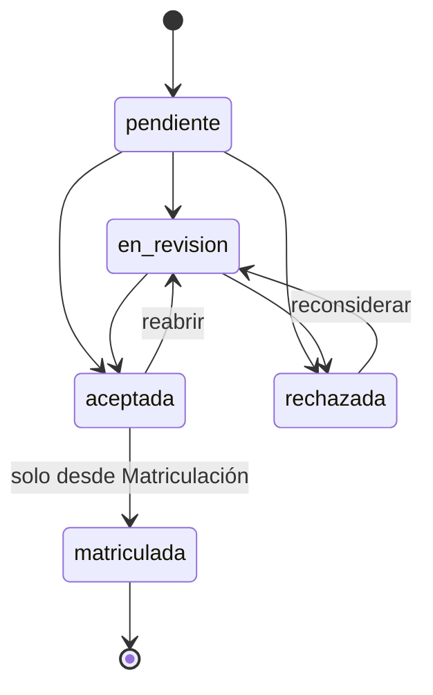
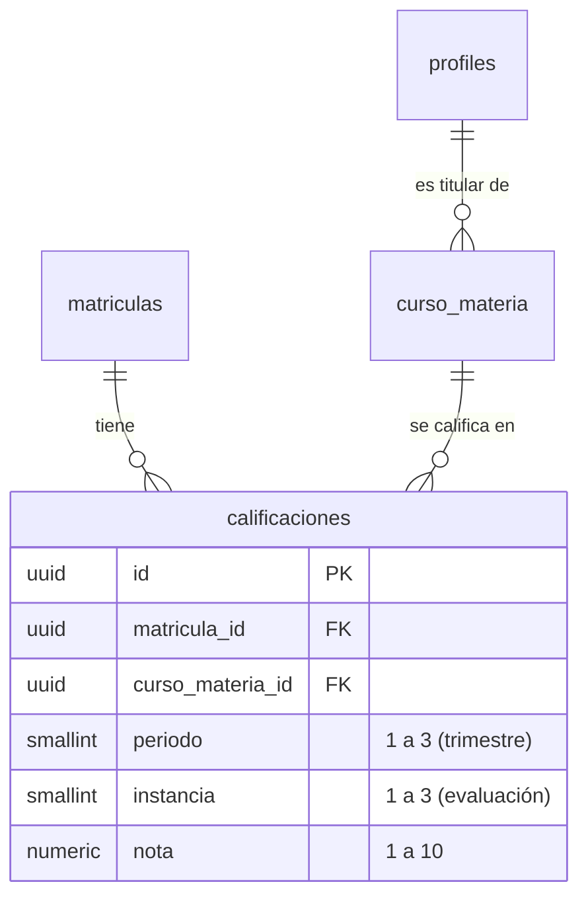

# Sprint 2 — Calificaciones y patrón State

Metodología de Sistemas II · UTN FRRe · TUP 2026
Centro Educativo *"Educar para Transformar"* — **Grupo 4**
Integrantes: Cerqueiro, Gonzalo — Fernández, Lautaro

| Dato | Valor |
|---|---|
| Sprint | 2 — Calificaciones, personal y trazabilidad |
| Fechas | 29/09/2026 al 13/10/2026 |
| Este documento | Avance al cierre de la **semana 1** (05/10/2026) |
| Patrón de diseño comprometido | State |

---

## 1. Estado al 05/10

| ID | Trabajo | Responsable | Estado |
|---|---|---|---|
| — | Patrón **State**: ciclo de vida de la solicitud de inscripción | Compartido | ✅ Terminado |
| HU2 | Modelo de calificaciones, pantalla de carga y promedio | G. Cerqueiro | ✅ Implementada — falta probar con usuarios reales |
| HU4 | Registrar asistencia diaria (arrastre del Sprint 1) | L. Fernández | ⏳ Sin iniciar |
| HU6 | Gestionar legajo de personal | L. Fernández | ⏳ Sin iniciar |
| REQ-20 · REQ-22 | Postulaciones y auditoría | Semana 2 | ⏳ Planificados |

HU2 estaba planificada en dos semanas —modelo y pantalla en la primera,
validación de rango y promedio en la segunda—. Se completó entera en la
primera, porque el modelo de la Parte 2 ya tenía todo lo que las notas
necesitaban: el alumno matriculado y la materia con su docente.

---

## 2. Patrón State — la solicitud de inscripción

### Qué problema había

La pantalla de Inscripciones dejaba elegir cualquier estado desde cualquier
otro. Una solicitud ya **matriculada** podía volver a *pendiente* y procesarse
de nuevo, lo que rompía un criterio de aceptación de HU1: *"la solicitud queda
en estado matriculado y no puede duplicarse"*. Era una deuda registrada en la
retrospectiva del Sprint 1.

### Cómo se resolvió

Cada estado es un objeto que sabe a qué estados puede pasar. La pantalla deja de
decidir: le pregunta al estado actual.

| Pieza | Archivo | Rol en el patrón |
|---|---|---|
| `EstadoSolicitud` | `src/domain/estadoSolicitud.js` | Estado base: `puedePasarA()`, `pasarA()`, `esFinal` |
| `Pendiente`, `EnRevision`, `Aceptada`, `Rechazada`, `Matriculada` | ídem | Estados concretos: cada uno declara sus transiciones |
| `Matriculada.pasarA()` | ídem | Redefine el comportamiento: en vez de solo prohibir, explica qué hacer |
| `inscripciones.cambiarEstado()` | `src/services/inscripciones.js` | Contexto: delega la decisión en el estado actual antes de guardar |

Qué cambió para quien usa el sistema:

- El selector de estado **solo ofrece las transiciones válidas**.
- *Matriculada* no se puede elegir a mano: ese estado lo produce únicamente el
  circuito de Matriculación (HU1), que también consulta al estado antes de
  crear el alumno.
- Una solicitud matriculada aparece **bloqueada**, con un mensaje que indica
  cómo corregir un error (dar de baja la matrícula).

### Las dos capas

La misma tabla de transiciones está en la base, en el disparador
`trg_transicion_solicitud` de [`docs/supabase-sprint2.sql`](../../supabase-sprint2.sql).
Si alguien modifica una solicitud por fuera de la aplicación, la base también
lo rechaza. Es la regla del proyecto: **toda validación vive en la interfaz y
en la base**.

---

## 3. HU2 — Cargar calificaciones de alumnos (REQ-15)

### Qué se construyó

| Pieza | Dónde |
|---|---|
| Tabla `calificaciones`, disparador y vista `promedios_periodo` | `docs/supabase-sprint2.sql` |
| Servicio de calificaciones (Facade) | `src/services/calificaciones.js` |
| Inicio del módulo Profesores: *Mis cursos* | `/docente` — `src/pages/docente/MisCursosPage.jsx` |
| Planilla de notas por trimestre | `/docente/calificaciones/:id` — `src/pages/docente/CalificacionesPage.jsx` |
| Acceso desde el panel del docente | `src/components/dashboard/DashboardPersonal.jsx` |

### Modelo

La nota cuelga de la **matrícula** —no del alumno— para que quede atada al
ciclo lectivo, y del **dictado** (`curso_materia`) para saber quién es el
docente titular. No hizo falta ninguna tabla nueva de cursos ni de docentes:
todo eso ya lo había dejado el Sprint 1.

### Criterios de aceptación

| Criterio | Interfaz | Base de datos |
|---|---|---|
| El docente titular carga y edita notas de su materia | *Mis cursos* lista solo sus materias; la planilla guarda y edita | Política `calificaciones_docente` |
| Nota fuera de rango → se rechaza con mensaje de corrección | La celda se marca en rojo, se explica el rango y el botón Guardar se deshabilita | `CHECK calificacion_nota_en_rango` (1 a 10) |
| Al guardar, el promedio del período se recalcula automáticamente | Después de guardar se vuelve a leer el promedio | Vista `promedios_periodo`: se calcula en cada consulta, nunca queda desactualizado |
| Un docente no titular no puede editar notas ajenas | La planilla muestra *"Solo el docente titular…"* | `calificaciones_docente` exige `curso_materia_id` dentro de `dictados_del_docente()` |

Además, un disparador impide calificar a un alumno que no esté matriculado en
el curso donde se dicta la materia.

### Una decisión de seguridad que vale la pena explicar

La vista de promedios se creó con `security_invoker = true`. Sin esa opción,
PostgreSQL ejecuta la vista con los permisos de su dueño y **saltea las
políticas RLS**: cualquier usuario autenticado vería los promedios de todos los
alumnos. Con la opción, la vista respeta las mismas reglas que la tabla.

---

## 4. Cómo probarlo

1. Supabase → SQL Editor → ejecutar [`docs/supabase-sprint2.sql`](../../supabase-sprint2.sql).
2. Como `admin`, en **Cursos y materias**, asignar una materia a un curso con
   alumnos matriculados y elegir como docente a un usuario de rol `docente`.
3. Entrar con ese docente → **Mi panel** → **Mis cursos** → elegir la materia.

| ID | Caso | Resultado esperado | Resultado |
|---|---|---|---|
| CP-38 | El docente abre *Mis cursos* | Ve solo las materias que tiene asignadas | ✅ Solo Lengua y Literatura de 3.º A |
| CP-39 | Cargar notas válidas y guardar | Se guardan y aparece el promedio del trimestre | ✅ 8 y 6 → promedio 7,00 |
| CP-40 | Escribir `11` o `0` en una celda | La celda se marca, se explica el rango y no deja guardar | ✅ Con 11 y con 0 |
| CP-41 | Escribir `7,555` | Se marca: *"Hasta dos decimales"* | ✅ El detalle aparece como ayuda emergente de la celda |
| CP-42 | Modificar una nota y guardar | El promedio cambia sin recargar la página | ✅ 6 → 9, promedio 8,50 sin recargar |
| CP-43 | Vaciar una celda y guardar | La nota se borra y el promedio se recalcula | ✅ Promedio 8,00; la nota se borró de la base |
| CP-44 | Cambiar de trimestre con cambios sin guardar | Pide confirmación antes de descartarlos | ✅ Al cancelar conserva las notas |
| CP-45 | Otro docente abre la URL de esa materia | *"Solo el docente titular puede cargar estas notas"* | ✅ En las dos capas: la pantalla lo bloquea y la base rechaza la nota (42501) |
| CP-46 | Inscripciones → abrir una solicitud *pendiente* | El selector ofrece en revisión, aceptada y rechazada | ✅ |
| CP-47 | Abrir una solicitud *matriculada* | El selector está bloqueado y explica cómo corregir | ✅ |
| CP-48 | En SQL: `UPDATE inscripciones SET estado = 'pendiente' WHERE estado = 'matriculada'` | La base lo rechaza: *"Una solicitud en estado matriculada no puede pasar a pendiente"* | ✅ |

### Resultado de las pruebas (21/10)

Los once casos pasaron. Durante la ejecución aparecieron dos cosas, ya corregidas:

- **Lectura de notas sin el rol vigente.** A un titular al que se le cambiaba el
  rol (por ejemplo, a padre) la política de lectura le seguía mostrando las notas
  de sus materias: `dictados_del_docente()` solo miraba `docente_id`. Ahora exige
  además `tiene_rol('docente')`, en `docs/supabase-sprint2.sql`. **Hay que volver
  a ejecutar el script** para que la corrección llegue a la base.
- **Redacción del aviso.** Al guardar una sola nota decía *"Se guardaron 1 nota"*.

---

## 5. Qué falta para cerrar el Sprint 2 (13/10)

- [x] Patrón State en la solicitud de inscripción, en las dos capas
- [x] HU2 — modelo, planilla de carga, validación de rango y promedio
- [x] Ejecutar `supabase-sprint2.sql` y los casos CP-38 a CP-48
- [ ] HU4 — asistencia diaria (L. Fernández) — se apoya en el módulo Profesores ya creado
- [ ] HU6 — legajo de personal (L. Fernández)
- [ ] REQ-20 — postulaciones laborales sobre la máquina de estados
- [ ] REQ-22 — registro de auditoría
- [ ] Sprint Review y Retrospectiva
