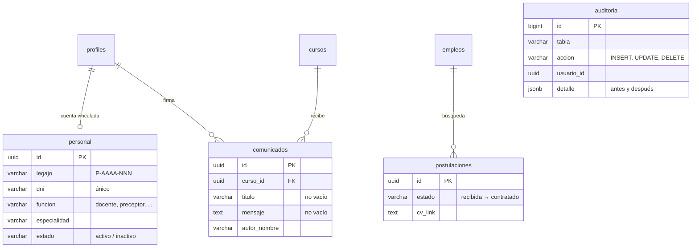

# Sprint 3 — Comunicación, reportes, personal y trazabilidad

Metodología de Sistemas II · UTN FRRe · TUP 2026
Centro Educativo *"Educar para Transformar"* — **Grupo 4**
Desarrollo: Cerqueiro, Gonzalo (desde el 21/10 continúa solo el desarrollo del equipo)

| Dato | Valor |
|---|---|
| Sprint | 3 — Comunicación, reportes e integración final |
| Fechas | 14/10/2026 al 27/10/2026 |
| Entrega | 27/10/2026 — Parte 2 completa (web + Sistema de Gestión) |
| Script de base de datos | [`docs/supabase-sprint3.sql`](../../supabase-sprint3.sql) — ejecutado el 24/10 |

---

## 1. Alcance

El Sprint 3 absorbe todo lo que quedó pendiente del backlog (ver
[cierre del Sprint 2](../05-cierre-sprint-2/README.md)).

| ID | Trabajo | Puntos | Estado |
|---|---|---|---|
| HU4 | Registrar asistencia diaria | 3 | ✅ Implementada |
| HU5 | Enviar comunicado a padres del curso | 2 | ✅ Implementada |
| HU6 | Gestionar legajo de personal | 5 | ✅ Implementada |
| HU3 | Consultar indicadores institucionales | 8 | ✅ Implementada |
| REQ-17 | Boletines y constancias en PDF | 3 | ✅ Implementado |
| REQ-20 | Postulaciones laborales | 2 | ✅ Implementado |
| REQ-22 | Auditoría de acciones críticas | 3 | ✅ Implementado |
| — | Unidad 4: integración continua (GitHub Actions) y tablero Kanban | — | ✅ Pipeline · ⏳ Tablero |

---

## 2. Qué se construyó

| Historia | Pantalla | Base de datos | Servicio |
|---|---|---|---|
| HU4 | Mis cursos → **Tomar asistencia** (`/docente/asistencia/:curso`) | `asistencias` (Sprint 1) + `trg_validar_asistencia` | `asistencias.js` |
| HU5 | Mis cursos → **Comunicados** (`/docente/comunicados`) | `comunicados` + `cursos_del_docente()` | `comunicados.js` |
| HU6 | Panel → **Personal** | `personal` + `trg_sincronizar_acceso_personal` | `personal.js` |
| HU3 | Panel → **Indicadores** (exporta a PDF) | Lee matrícula, asistencia y notas | `indicadores.js` |
| REQ-17 | **Boletín** y **constancia** (`/documentos/...`) | Lee matrícula, promedios y asistencia | `documentos.js` |
| REQ-20 | Panel → **Postulaciones** · web → Empleo | `postulaciones` + `trg_transicion_postulacion` | `postulaciones.js` |
| REQ-22 | Panel → **Auditoría** | `auditoria` + `registrar_auditoria()` | `auditoria.js` |
| Familias | Mi panel → **Mis hijos** / **Mi seguimiento** | `cursos_de_la_familia()`, políticas del alumno | `familia.js` |

### Modelo agregado

### Decisiones que vale la pena explicar

- **El estado del legajo corta el acceso (HU6).** `rol_actual()` devuelve el rol solo si
  la cuenta está activa, y todas las políticas preguntan por el rol con `tiene_rol()`. Dar
  de baja un legajo desactiva su cuenta por disparador, así que esa persona pierde los
  permisos en la base, no solo en la pantalla.
- **Las postulaciones usan el patrón State (REQ-20).** Mismo esquema que la solicitud de
  inscripción: `src/domain/estadoPostulacion.js` en la aplicación y
  `trg_transicion_postulacion` en la base. Los CV que antes llegaban como mensaje de
  contacto se migraron a la tabla nueva.
- **La auditoría la escribe la base (REQ-22).** Un disparador genérico guarda quién, cuándo
  y qué cambió (solo los campos modificados, con su valor anterior y el nuevo). La
  aplicación no puede insertar, modificar ni borrar entradas.
- **El PDF sale de la impresión del navegador (HU3, REQ-17).** El boletín, la constancia y
  los indicadores tienen una hoja de estilos de impresión; no se sumó ninguna librería.
- **El remitente queda firmado (HU5).** Las familias no pueden leer los perfiles de los
  docentes, así que el nombre del autor se guarda en el comunicado al enviarlo.
- **Vincular cuentas.** Si un padre o un alumno se registra después de la matriculación,
  Administración lo vincula al legajo por DNI desde el detalle del alumno.

---

## 3. Casos de prueba

Datos de partida: el alumno de 3.º A matriculado en el Sprint 1, el docente de prueba
titular de Lengua y Literatura y una cuenta de padre vinculada desde Alumnos.

| ID | Historia | Caso | Resultado esperado | Resultado |
|---|---|---|---|---|
| CP-49 | HU4 | Docente → Mis cursos | Ve "Asistencia diaria" con sus cursos, sin repetir | |
| CP-50 | HU4 | Marcar la asistencia y guardar | *"Asistencia del … guardada"* | ✅ Prueba rápida 24/10 |
| CP-51 | HU4 | Abrir el mismo día y cambiar un estado | Aparece lo guardado; se actualiza sin duplicar | |
| CP-52 | HU4 | Elegir una fecha futura | El selector no lo permite; por API la base lo rechaza | |
| CP-53 | HU4 | Un docente de otro curso abre la URL | *"Solo los docentes del curso pueden tomar asistencia"* | |
| CP-54 | HU4 | El padre vinculado entra a su panel | Ve el porcentaje y las inasistencias del hijo | |
| CP-55 | HU5 | Enviar un comunicado vacío | No se envía y se marca el campo | |
| CP-56 | HU5 | Enviar un comunicado | Aparece en "Enviados" con fecha y remitente | ✅ Prueba rápida 24/10 |
| CP-57 | HU5 | Padre del curso y padre de otro curso | El primero lo ve con el remitente; el segundo no | |
| CP-58 | HU6 | Crear un legajo | Se genera el legajo P-AAAA-NNN | ✅ Prueba rápida 24/10 |
| CP-59 | HU6 | Crear otro con el mismo DNI | *"Ya existe un legajo de personal con ese DNI."* | ✅ Prueba rápida 24/10 |
| CP-60 | HU6 | Editar los datos del legajo | Se guardan | |
| CP-61 | HU6 | Vincular la cuenta de un docente | Muestra las materias a cargo | |
| CP-62 | HU6 | Dar de baja el legajo y entrar con esa cuenta | *"Tu cuenta está inactiva"*; al reactivar vuelve el acceso | |
| CP-63 | REQ-20 | Postularse desde /empleo | Aparece en Postulaciones como *Recibida* | |
| CP-64 | REQ-20 | Abrir una postulación recibida | Ofrece En revisión y Descartado, no Contratado | |
| CP-65 | REQ-20 | Llevarla hasta Contratado | Queda bloqueada | |
| CP-66 | REQ-20 | En SQL: `UPDATE postulaciones SET estado = 'contratado' WHERE estado = 'recibida'` | La base lo rechaza | |
| CP-67 | REQ-22 | Cambiar el rol de un usuario | Aparece en Auditoría con usuario y *"rol: padre → docente"* | ✅ Prueba rápida 24/10 |
| CP-68 | REQ-22 | Cargar una nota | Aparece como alta en Calificaciones | |
| CP-69 | REQ-22 | Un docente consulta `auditoria` por API | No recibe filas | |
| CP-70 | HU3 | La Autoridad abre Indicadores | La matrícula por nivel y curso coincide con Alumnos | ✅ Prueba rápida 24/10 |
| CP-71 | HU3 | Cambiar el período | Los valores cambian; sin datos dice *"Sin datos disponibles"* | |
| CP-72 | HU3 | Exportar a PDF | El PDF sale sin el menú del panel | |
| CP-73 | REQ-17 | Boletín de un alumno con notas | Promedios por trimestre y anual, más la asistencia | ✅ Prueba rápida 24/10 |
| CP-74 | REQ-17 | Constancia con matrícula activa y con matrícula en baja | La primera se emite; la segunda no | |
| CP-75 | REQ-17 | Un padre abre el boletín de un alumno que no es su hijo | *"No encontramos esa matrícula o no tenés permiso…"* | |
| CP-76 | — | Vincular un padre por DNI desde Alumnos | Aparece en Tutores vinculados; un DNI inexistente se informa | |

### Pruebas automáticas

Además de los casos manuales, 23 pruebas unitarias con **Vitest** cubren las reglas de
negocio que la interfaz valida antes de ir a la base: los dos patrones State, la
validación de notas, el resumen de asistencia, la auditoría y las fechas. Corren en cada
push dentro del pipeline de GitHub Actions (`npm test`).

---

## 4. Definition of Done

| Punto | Estado |
|---|---|
| Criterios de aceptación | ✅ Implementados en las siete historias |
| Pruebas funcionales y de integración | 🔶 Prueba rápida hecha; faltan los casos sin resultado |
| Permisos por rol con RLS | ✅ Políticas en `supabase-sprint3.sql` |
| Código en el repositorio con revisión | ✅ Por PR, verificado por el pipeline (sin revisión cruzada desde el 21/10) |
| Desplegado en Netlify + Supabase | ✅ PR #14 integrado y publicado el 24/10 |
| Documentación actualizada | ✅ Este documento |
