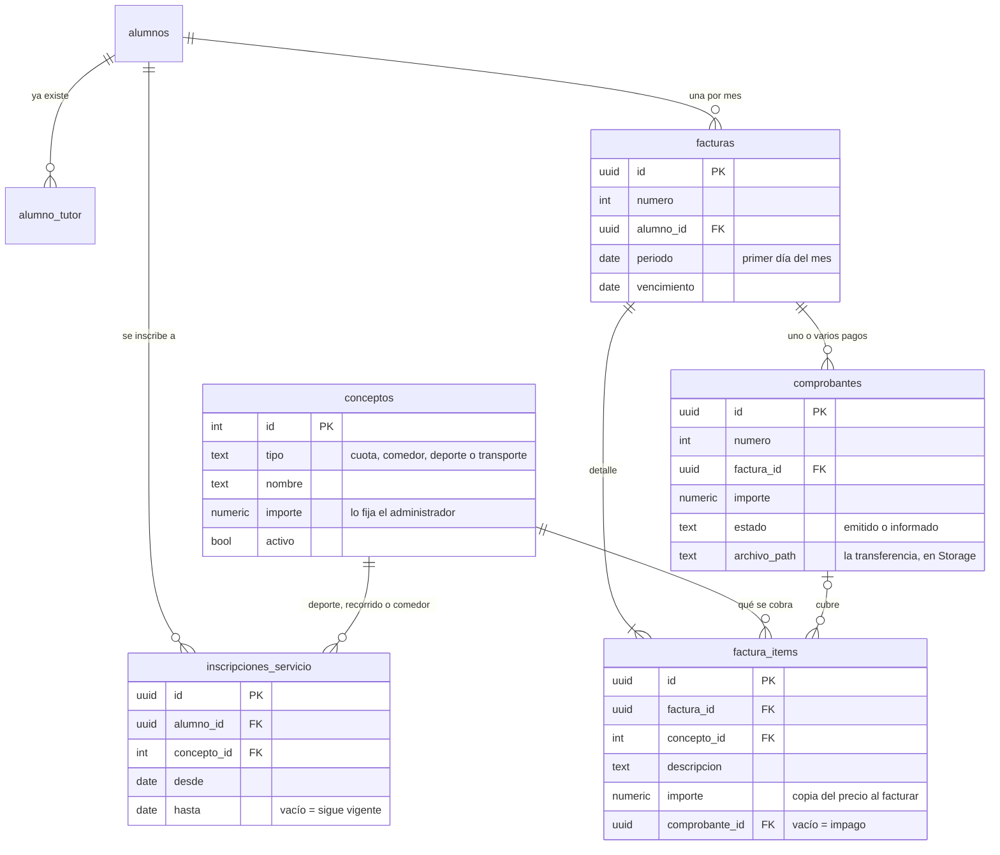

# Parte 3 — Etapa 1: modelo de datos de cobranza

Metodología de Sistemas II · UTN FRRe · TUP 2026
Centro Educativo *"Educar para Transformar"* — **Grupo 4**

| Dato | Valor |
|---|---|
| Requerimientos | REQ-24 a REQ-28 (cuotas, comprobantes, historial y deuda por ítem) |
| Scripts | [`docs/supabase-cobranza.sql`](../../supabase-cobranza.sql) (modelo) · [`docs/supabase-cobranza-datos.sql`](../../supabase-cobranza-datos.sql) (datos de prueba) |
| Estado | ✅ Diseño validado, scripts ejecutados en Supabase y verificados el 09/11/2026 |

**Verificación realizada** (consultas al final de cada script):

| Prueba | Resultado esperado | Obtenido |
|---|---|---|
| Las 5 tablas tienen RLS activo | 5 filas con `rls_activo = true` | ✅ |
| Precios cargados | 14 conceptos | ✅ |
| Facturas de marzo y abril | Todas en estado `pendiente`; abril suma Natación y el Recorrido 1 | ✅ |
| Un tercer deporte simultáneo | Se rechaza: *"dos deportes como máximo al mismo tiempo"* | ✅ |
| Consulta como la cuenta de padre de prueba | Solo las facturas de sus hijos | ✅ |
| `generar_facturas()` como padre | Se rechaza: *"Solo la Administración puede generar las facturas"* | ✅ |

---

## 1. Qué problema resuelve

El Sistema de Gestión de la Parte 2 cubre lo académico: alumnos, tutores, cursos y
matrículas. **No tiene ningún dato económico.** La app móvil necesita saber cuánto debe
cada familia, por qué concepto, y registrar que pagó.

Este modelo agrega esa información **colgándola de las tablas que ya existen**, sin
crear un segundo padrón:

- El alumno sale de `alumnos`.
- Quién puede ver a cada alumno lo resuelve `alumno_tutor`, con la función
  `alumnos_a_cargo()`, que ya protege la Parte 2.
- Qué alumnos se facturan sale de `matriculas`: los que tienen una matrícula activa en
  el ciclo lectivo del mes.

## 2. Diagrama

Las tablas nuevas son las cinco del plan de trabajo. `alumnos` y `alumno_tutor` ya
existen.



## 3. Para qué está cada tabla

| Tabla | Qué guarda | Por qué así |
|---|---|---|
| `conceptos` | El catálogo de lo que se cobra: la cuota, el comedor, cada deporte y cada uno de los 4 recorridos, con su importe. | El enunciado dice que *"cada recorrido y deporte tienen valores diferenciados"* y que el administrador fija los valores. Un concepto por fila resuelve las dos cosas. |
| `inscripciones_servicio` | A qué servicios está anotado cada alumno, desde y hasta cuándo. | *"El transporte es opcional, por lo que puede variar de un mes a otro"*: la inscripción tiene un período, y cada factura toma solo lo vigente en su mes. |
| `facturas` | Una factura por alumno y por mes, con su vencimiento. | La restricción única (alumno, período) impide facturar dos veces el mismo mes. |
| `factura_items` | Un renglón por concepto cobrado. | Es lo que permite *"discriminar la deuda por cada ítem de pago"* y que el padre *"seleccione los ítems a pagar"*. El importe se **copia** al facturar: si el administrador sube un precio, las facturas viejas no cambian. |
| `comprobantes` | Cada pago de una factura. | Una fila cubre los dos momentos del enunciado: el sistema **emite** el comprobante con los ítems elegidos, y después el padre **carga** el archivo de la transferencia. Una factura puede tener varios (*"una factura puede tener más de un comprobante"*). |

## 4. Cómo se recorre un pago

```text
1. El administrador fija los importes ............ conceptos
2. Se generan las facturas del mes ............... generar_facturas('2027-04-01')
      → una factura por alumno matriculado, con un ítem por la cuota
        y uno por cada servicio vigente en ese mes
3. El padre ve la factura en la app .............. vista facturas_estado
4. Elige los ítems a pagar ........................ emitir_comprobante(factura, ítems)
      → comprobante N.º X en estado "emitido", con el importe a transferir
5. Transfiere y sube la foto o el PDF ............. Storage + informar_transferencia()
      → el comprobante pasa a "informado" y esos ítems cuentan como pagados
```

## 5. Dónde se controla cada regla

Como en la Parte 2, las reglas viven **en la base**. La app solo las muestra, así que
ningún cliente puede saltearlas.

| Regla | Cómo se controla |
|---|---|
| Un padre solo ve a sus hijos | RLS con `alumnos_a_cargo()` en las cinco tablas y en el bucket de archivos |
| Solo el administrador fija los valores | RLS: únicamente el rol `admin` escribe en `conceptos`, y cada cambio de precio queda en la auditoría |
| No facturar dos veces el mismo mes | Restricción única `(alumno_id, periodo)` en `facturas` |
| No pagar dos veces el mismo ítem | `emitir_comprobante()` rechaza los ítems que ya tienen comprobante |
| Hasta dos deportes a la vez, un recorrido a la vez, sin inscripciones duplicadas | Disparador sobre `inscripciones_servicio` que compara los períodos que se superponen |
| Solo transferencias, nunca efectivo | No hay forma de registrar un pago sin pasar por `comprobantes`, y un comprobante informado exige el archivo |
| El padre no puede marcar pagos a mano | No tiene permiso de escritura sobre las tablas: solo puede llamar a `emitir_comprobante()` e `informar_transferencia()`, que validan todo dentro de una única transacción |

## 6. El estado de la factura se calcula, no se guarda

El plan guardaba en `facturas` un total y un estado. Acá se propone **calcularlos** en
una vista, `facturas_estado`:

| Dato | Cálculo |
|---|---|
| Total | Suma de los ítems |
| Pagado | Suma de los ítems cuyo comprobante está *informado* |
| Saldo | Total − pagado |
| Estado | `pagada` si el saldo es 0 · `parcial` si se pagó algo · `pendiente` si no se pagó nada |
| Vencida | Hay saldo y ya pasó el vencimiento |

**Por qué:** un total o un estado guardados pueden quedar desactualizados si alguien
modifica un ítem y se olvida de recalcularlos. Si se calculan, no hay nada que
desactualizar. Es la respuesta del plan a *"cómo se mantienen sincronizados"*: la web y
la app leen la misma vista.

## 7. Diferencias con el plan de trabajo

| Plan | Diseño | Motivo |
|---|---|---|
| `facturas` guarda total y estado | Se calculan en la vista `facturas_estado` | Evitar datos que se contradigan (sección 6) |
| Patrón **State** sobre la factura, en la base | El estado se calcula en la base. El patrón State se aplica en la app, para decidir qué acciones ofrece cada estado: por ejemplo, una factura `pagada` no muestra "Pagar" | La base garantiza el dato y la app decide el comportamiento |
| Patrón **Strategy** para calcular importes | No hace falta | Cada deporte y cada recorrido es un concepto con su propio importe: el cálculo es igual para todos |
| Conflictos de horario entre deportes | Fuera del alcance mínimo | Requiere modelar grupos y horarios de cada deporte. Se resigna con la inscripción desde la app (HU-M5), igual que preveía el plan |

## 8. Fuera del alcance mínimo

- Grupos, horarios y profesor responsable de cada deporte (y el control de superposición).
- Validación del pago por parte del administrador: hoy, el pago cuenta en cuanto el
  padre informa la transferencia.
- Anulación de un comprobante emitido que nunca se pagó.
- Correos automáticos del día 20 y del último día hábil (REQ-30 y REQ-31).
